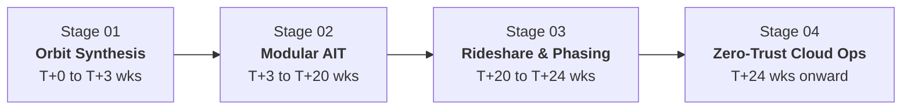

# AeroGrid OS

> **ORBIT ON DEMAND. OWNED BY YOU.**  
> *Deploy a Sovereign Satellite Constellation in 180 Days at 91% Reduced Cost.*


---

## 🛰 Overview

**AeroGrid OS** is an elite, 60FPS WebGL scrollytelling platform designed for Sovereign Satellite Constellations and Autonomous Drone Swarms. From initial orbit synthesis to live ground-station API integration in two quarters (180 days), AeroGrid replaces multi-year, bespoke legacy space programs ($38M+ per satellite) with standardized modular payloads, rideshare launch integration, autonomous in-orbit phasing, and guaranteed turnkey pricing ($3.2M all-in).

---

## ⚡ Value Architecture

| Metric | Specification | Impact |
|:---|:---|:---|
| **Timeline** | **180 Days Flat** | Contract signing to first light on-orbit (vs. 4–6 years legacy) |
| **Cost Savings** | **−91% to −95%** | $3.2M / satellite turn-key (vs. $38M / sat + $25M ground overhead) |
| **Telemetry Rate** | **10 Hz Real-Time** | Sub-90s tasking turnaround and direct-to-cloud API downlinks |
| **AIT Cadence** | **1 Sat / 6 Days** | Automated flight-line parallel integration & environmental screening |

---

## 🔄 4-Phase Mission Lifecycle



1. **Stage 01: Mission Definition & Orbit Synthesis (T+0 to T+3 weeks)**  
   Algorithmic synthesis engine resolves area of interest (AOI), temporal revisit targets, and sensor suites into locked orbital planes (520 km SSO, 97.5°), link budgets, and fixed-price contracts within 21 days.
2. **Stage 02: Modular Payload Assembly & AIT (T+3 to T+20 weeks)**  
   Space-qualified modular sensors mount to a standardized 28V / SpaceWire / Ethernet bus. Parallel thermal-vacuum (TVAC), random vibration, and EMC testing on a 1 satellite every 6 days flight-line cadence.
3. **Stage 03: Rideshare Launch & Autonomous Orbit Insertion (T+20 to T+24 weeks)**  
   Dedicated rideshare deployment to 520 km SSO. Onboard GNC autonomously detumbles, deploys solar arrays, acquires GNSS fix, and executes electric propulsion phasing burns with zero ground intervention.
4. **Stage 04: Real-time Cloud Operations & Direct-to-API Downlink (T+24 weeks onward)**  
   Tasking requests compiled into on-orbit schedules in < 90 seconds. Filtered edge-AI data downlinked over encrypted X-band to global ground stations (Svalbard, Inuvik, Punta Arenas) in < 5 minutes.

---

## 📦 Five Modular Payload Specifications

| # | Codename | Category | Sensor Specs / Swath | Mass | Power (Avg/Peak) | Downlink Rate | Primary Application |
|:---|:---|:---|:---|:---|:---|:---|:---|
| 01 | **HyperEye-V2** | Optical Multispectral | 0.5m PAN / 2.0m MS (8 bands), 12 km swath | 24 kg | 38W / 85W | 1.4 Gbps raw → 180 Mbps | Crop-stress, defense order-of-battle, infrastructure audits |
| 02 | **ThermoScan-L3** | Thermal Infrared (LWIR 8–12µm) | 30m GSD, 60 km swath, NETD < 50 mK | 9.5 kg | 22W / 30W | 85 Mbps | Wildfire ignition, nighttime maritime vessel detection |
| 03 | **Sentinel-SAR X1** | Synthetic Aperture Radar (9.65 GHz) | 1.0m stripmap (20 km) / 0.5m spotlight (5×5 km) | 58 kg | 120W / 1.2 kW burst | 1.2 Gbps raw | Day/night all-weather border surveillance, subsidence tracking |
| 04 | **NeuralCore-E2** | Edge-AI Neural Processor | 64 TOPS @ 15W, < 200ms inference | 1.8 kg | 15W / 25W | 2 Mbps (98% reduction) | Onboard automatic ship/flame detection and instant cueing |
| 05 | **LinkMesh-D2C** | Direct-to-Cell RF Mesh | 3GPP NTN NB-IoT, ~500 km beam footprint | 14 kg | 60W / 110W | 40 Mbps aggregate | Global remote IoT sensor backhaul, emergency SOS mesh |

---

## 📊 Live Orbit Telemetry HUD

```
LINK: NOMINAL · AES-256: LOCKED · NEXT AOS: SVALBARD T-04:12 · EDGE-AI QUEUE: 3 · DOD: 18%
```

- **Orbital Parameters**: 520 km Sun-synchronous orbit, 7.605 km/s velocity, 97.5° inclination, 94.9 min period.
- **Power Subsystem**: 640W peak solar bus, 28V regulated rail, 280 Wh Li-ion, 18% nominal DoD (32% peak SAR burst).
- **RF Subsystem**: X-band payload downlink at 800 Mbps (1.2 Gbps peak DVB-S2X), AES-256-GCM encryption, S-band TT&C.
- **Ground Station Network**: SvalSat (78.2°N, 9.2 min pass, ~55 GB), Inuvik (68.4°N), Punta Arenas (53.2°S), Troll Antarctica (72.0°S), Awarua NZ (46.5°S).

---

## 📐 Constellation Economics & Revisit Formulation

Revisit frequency is governed by the orbital mechanics equation:

$$T_{\text{rev}} \approx \frac{24\,\text{h}}{N \cdot k}$$

Where:
- $N$ = Number of satellites in constellation (phased across orbital planes)
- $k$ = Effective accesses per satellite per day ($k = 2$ for SAR/LWIR day/night passes; $k = 1$ for daylight optical)

### Fixed Turnkey Pricing Comparison (5-Year All-In Lifecycle)

| Target Revisit | Fleet $N$ (SAR/LWIR) | AeroGrid Fixed Cost | Legacy Program Cost | Capital Saved | % Saved |
|:---|:---:|:---:|:---:|:---:|:---:|
| **24 Hours** | 1 | **$3.2M** | $63.0M | $59.8M | 94.9% |
| **6 Hours** | 2 | **$6.4M** | $101.0M | $94.6M | 93.7% |
| **3 Hours** | 4 | **$12.8M** | $177.0M | $164.2M | 92.8% |
| **1 Hour** | 12 | **$38.4M** | $481.0M | $442.6M | 92.0% |
| **30 Minutes** | 24 | **$76.8M** | $937.0M | $860.2M | 91.8% |
| **15 Minutes** | 48 | **$153.6M** | $1,849.0M | $1,695.4M | 91.7% |

*AeroGrid includes satellite build ($1.9M), dedicated rideshare slot ($0.55M), 5-year ground & flight operations ($0.75M), and launch insurance.*

---

## 🎯 Real-World Mission Case Studies

1. **NATO Maritime & Border Surveillance (1.2M km² EEZ)**  
   - **Fleet**: 12 satellites (8× Sentinel-SAR X1, 4× HyperEye-V2) + NeuralCore-E2.  
   - **Outcome**: 60-minute full EEZ revisit with 94% dark-vessel detection rate; alert latency < 4 minutes; cut unnecessary patrol sorties by 38% in year 1.
2. **Critical Infrastructure & Wildfire Early Warning (340,000 km² Forest / Grid)**  
   - **Fleet**: 24 satellites (12× ThermoScan-L3, 8× HyperEye-V2, 4× Sentinel-SAR X1).  
   - **Outcome**: 30-minute thermal revisit; ignitions $\ge 100\,\text{m}^2$ detected within 6 minutes; smoke-penetrating SAR/LWIR fusion enables real-time evacuation coordination.
3. **High-Frequency Environmental & Agricultural Intelligence (3.1M Hectares)**  
   - **Fleet**: 4× HyperEye-V2 satellites.  
   - **Outcome**: 6-hour daylight revisit; crop-stress canopy indices delivered every pass via REST API; yield forecasts achieve $\pm 4\%$ accuracy 6 weeks before harvest; claims verification accelerated from weeks to 48 hours.

---

## 🚀 Getting Started

### Prerequisites
- Node.js 18+ (tested on Node v20 / v24)
- npm or yarn

### Installation & Local Run

```bash
# Clone the repository
git clone https://github.com/Shubham-dev-stack/AeroGrid-OS.git
cd AeroGrid-OS

# Install dependencies
npm install

# Start development server
npm run dev
```

Open [http://localhost:3000](http://localhost:3000) to view the 60FPS WebGL cinematic experience.

### Production Build

```bash
npm run build
npm start
```

---

## 🛠 Tech Stack

- **Framework**: Next.js 14 (App Router, TypeScript)
- **3D Graphics & Engine**: Three.js WebGL Engine, Custom GLTF Shaders, PBR Materials
- **Scrollytelling**: GSAP ScrollTrigger, Lenis Smooth Scroll
- **Styling**: Tailwind CSS, PostCSS, Custom AeroGrid HUD Design System
- **Icons**: Lucide React

---

## 📜 License & Intellectual Property

MIT License © 2026 AeroGrid OS Architecture. Design-reference data validated for space systems engineering benchmarks.
