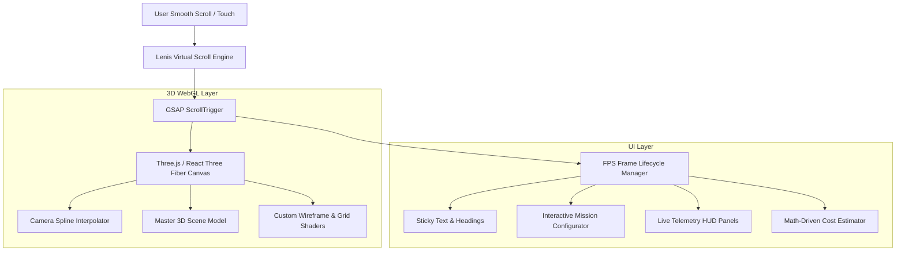

# AeroGrid OS System Architecture

## Overview
AeroGrid OS is architected as a hybrid Next.js 14 WebGL application combining high-performance client rendering with responsive, accessible HTML/CSS UI overlays.

## Architectural Layers

## Camera Waypoints

| Waypoint | Stage | Position (X, Y, Z) | LookAt (X, Y, Z) | Description |
|:---|:---|:---|:---|:---|
| 01 | Hero & Overview | `(0, 1.2, 5.8)` | `(0, 0, 0)` | Front 3/4 perspective of full hardware |
| 02 | Mission Lifecycle | `(-2.4, 0.7, 3.3)` | `(-0.2, 0.1, 0.2)` | Avionics and central bay zoom |
| 03 | Modular Payloads | `(2.2, -0.4, 2.7)` | `(0.3, -0.15, 0.8)` | Sensor turret and optical gimbal close-up |
| 04 | In-Flight Telemetry | `(3.2, 1.8, 3.8)` | `(-0.4, 0.2, -0.2)` | Dynamic elevated side perspective |
| 05 | Mission Calculator | `(0, 4.6, 7.8)` | `(0, -0.3, 0)` | Wide orbital / constellation perspective |

## State Management
- `scrollState`: Mutable low-latency object storing `progress` and `velocity` accessed directly by `useFrame` at 60/120 FPS.
- `useScrollProgress`: React hook with `requestAnimationFrame` dampening for reactive DOM component synchronization.
